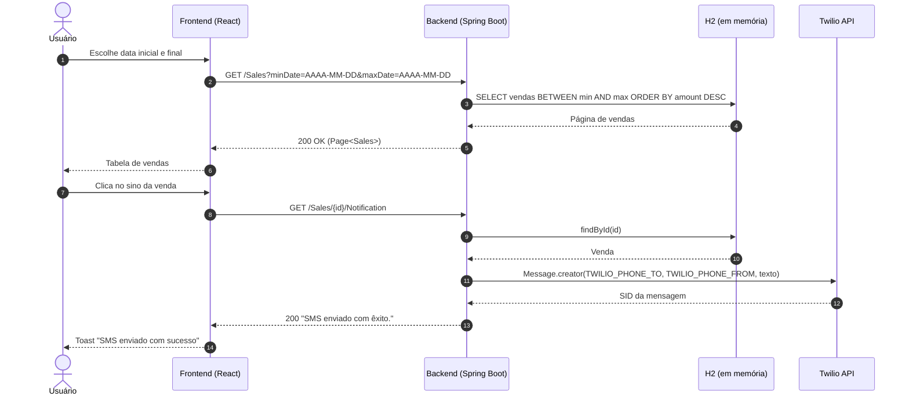
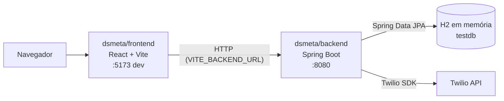
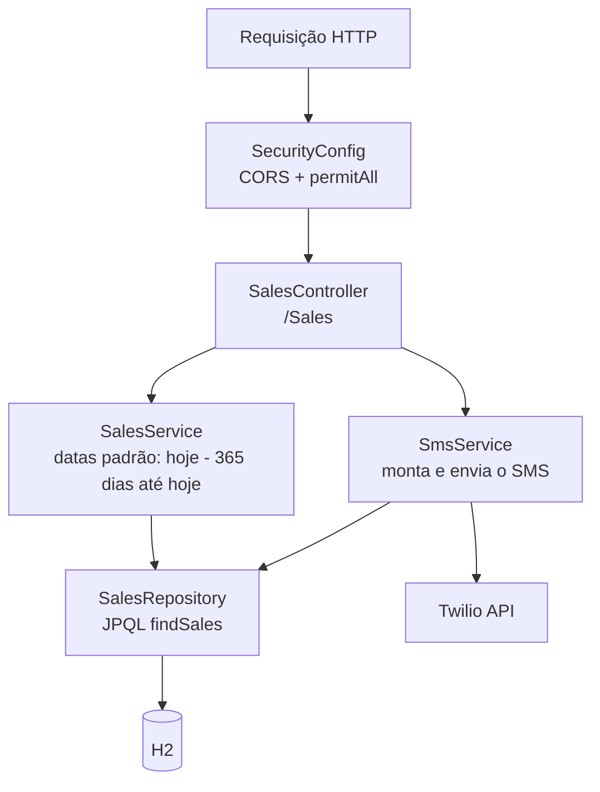
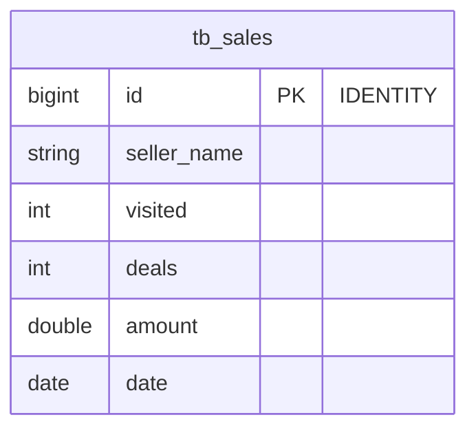

# 📊 DSMeta


> Gerenciamento de vendas: liste as vendas por período e notifique cada uma por SMS com um clique.

O **DSMeta** é um **sistema de gerenciamento de vendas desenvolvido com o treinamento da [DevSuperior](https://devsuperior.com.br)**, no evento **Semana Spring React**. A aplicação exibe uma tabela de vendas filtrada por intervalo de datas e, para cada venda, permite disparar uma notificação por SMS via **Twilio** com o resumo do desempenho do vendedor.


Este repositório é um **monorepo** com duas aplicações independentes (sem workspace ou build compartilhado):

| App | Caminho | Papel |
| :--- | :--- | :--- |
| **Backend** | [`dsmeta/backend`](dsmeta/backend) | API REST Spring Boot: consulta paginada de vendas por data (H2 em memória) e envio de SMS via Twilio |
| **Frontend** | [`dsmeta/frontend`](dsmeta/frontend) | SPA React + Vite: card com dois seletores de data, tabela de vendas e botão de notificação |



---

## ✨ O Problema
Acompanhar o desempenho de vendedores exige olhar registros por período e avisar alguém quando um resultado merece atenção. Fazer isso consultando planilhas e mandando mensagens manualmente é lento e fácil de esquecer.

---

## 🚀 A Solução
O DSMeta reúne as vendas numa tabela única, ordenada pelo valor total (maior primeiro) e filtrada por um intervalo de datas escolhido na tela. Ao lado de cada venda há um botão que pede ao backend para enviar um SMS, via Twilio, com a data, as visitas, as vendas fechadas, o vendedor e o total da venda.

---

## 🎯 Diferenciais
- **Filtro por período**: dois date pickers (`react-datepicker`, formato `dd/MM/yyyy`) recarregam a tabela automaticamente a cada mudança.
- **Ordenação por valor**: a consulta JPQL já devolve as vendas do maior para o menor `amount`.
- **Notificação por SMS**: um clique dispara o envio via Twilio SDK, com toast de confirmação (`react-toastify`).
- **Zero infraestrutura de banco**: H2 em memória populado no startup por [`import.sql`](dsmeta/backend/src/main/resources/import.sql) com 65 vendas de exemplo.
- **Layout responsivo**: colunas `ID`, `Visitas` e `Vendas` aparecem a partir de 992px e `Data` a partir de 576px.

---

## 🛠️ Stack Tecnológica

Versões conforme [`dsmeta/backend/pom.xml`](dsmeta/backend/pom.xml), [`maven-wrapper.properties`](dsmeta/backend/.mvn/wrapper/maven-wrapper.properties), [`dsmeta/frontend/package.json`](dsmeta/frontend/package.json) e [`yarn.lock`](dsmeta/frontend/yarn.lock).

### Backend (`dsmeta/backend`)

| Camada | Tecnologia |
|---|---|
| **Linguagem** | Java 17 (`java.version` no `pom.xml` e `java.runtime.version` em `system.properties`) |
| **Framework** | Spring Boot 2.7.1 (`spring-boot-starter-web`) |
| **Persistência** | Spring Data JPA (`spring-boot-starter-data-jpa`, `javax.persistence`) |
| **Banco de Dados** | H2 em memória (`jdbc:h2:mem:testdb`) com console em `/h2-console` |
| **Segurança** | Spring Security (`spring-boot-starter-security`) apenas para CORS, CSRF desabilitado e sessão stateless; todas as rotas liberadas |
| **SMS** | Twilio Java SDK 8.31.1 |
| **Build** | Maven Wrapper (Maven 3.8.5); artefato final `DSMetaAPI.jar` |
| **Outros** | `spring-boot-starter-validation` (declarado, sem uso no código), `spring-boot-devtools` |
| **Testes** | `spring-boot-starter-test` + `spring-security-test`; apenas o teste padrão `contextLoads` |

### Frontend (`dsmeta/frontend`)

| Camada | Tecnologia |
|---|---|
| **Framework** | React ^18.2.0 |
| **Build / Dev server** | Vite ^3.0.0 (`@vitejs/plugin-react` ^2.0.0) |
| **Linguagem** | TypeScript ^4.6.4 (4.7.4 no `yarn.lock`) |
| **HTTP** | Axios 0.27.2 |
| **Datas** | `react-datepicker` 4.8.0 |
| **Notificações** | `react-toastify` 9.0.5 |
| **Estilos** | CSS puro por componente + [`responsive.css`](dsmeta/frontend/src/assets/css/responsive.css) |
| **Gerenciador de pacotes** | Yarn (`yarn.lock` versionado) |

---

## 🏛️ Arquitetura

### Visão geral do monorepo



- Não há código compartilhado: o contrato é o JSON trocado via HTTP, espelhado no tipo [`Sale`](dsmeta/frontend/src/models/Sale.ts) do frontend.
- O commit "Heroku" adicionou [`system.properties`](dsmeta/backend/system.properties) (`java.runtime.version=17`), arquivo lido pelo buildpack Java do Heroku. Não há `Procfile` nem outra configuração de deploy no repositório.

### Backend (`dsmeta/backend`)

Camadas clássicas Controller → Service → Repository no pacote `com.devsuperior.dsmeta`:



| Pacote | Classe | Responsabilidade |
| :--- | :--- | :--- |
| `Configuration` | `SecurityConfig` | Desabilita CSRF e `frameOptions`, sessão stateless, `permitAll` em todas as rotas e CORS com `applyPermitDefaultValues()` + métodos `POST`, `GET`, `PUT`, `DELETE`, `OPTIONS` |
| `Controller` | `SalesController` | Rotas `/Sales` e `/Sales/{id}/Notification` |
| `Service` | `SalesService` | Converte `minDate`/`maxDate` (`LocalDate.parse`) e aplica o padrão de 365 dias quando vazios |
| `Service` | `SmsService` | Lê as credenciais Twilio (`twilio.*`), busca a venda e envia o SMS para o número fixo `TWILIO_PHONE_TO` |
| `Repository` | `SalesRepository` | `JpaRepository<Sales, Long>` com a consulta `BETWEEN :min AND :max ORDER BY obj.amount DESC` |
| `Model` | `Sales` | Entidade JPA mapeada para `tb_sales` |

Texto do SMS montado em [`SmsService`](dsmeta/backend/src/main/java/com/devsuperior/dsmeta/Service/SmsService.java):

```text
Na data <date>, com <visited> visitas e <deals> vendas, o vendedor <sellerName> obteve um total de R$<amount>
```

### Frontend (`dsmeta/frontend`)

Uma única página, sem roteador:

```
src/
├── main.tsx          ← createRoot + <App />
├── App.tsx           ← ToastContainer, <SalesCard /> e <Footer />
├── Components/
│   ├── SalesCard/          ← date pickers, chamada GET /Sales e tabela
│   ├── NotificationButton/ ← botão de sino: GET /Sales/{id}/Notification + toast
│   └── Footer/             ← links para GitHub e LinkedIn
├── models/Sale.ts    ← tipo Sale
└── utils/request.ts  ← BASE_URL
```

- **URL do backend**: [`utils/request.ts`](dsmeta/frontend/src/utils/request.ts) usa `import.meta.env.VITE_BACKEND_URL` e, se ausente, `http://localhost:8080`.
- **Datas**: o período inicial da tela é de hoje menos 365 dias até hoje; as datas são enviadas como `AAAA-MM-DD` (`toISOString().slice(0, 10)`).
- **Paginação**: o frontend não envia `page`/`size` e exibe só o `content` da primeira página (20 vendas, padrão do Spring Data).

---

## 🗄️ Modelo de Dados

Uma única tabela, criada pelo Hibernate a partir da entidade [`Sales`](dsmeta/backend/src/main/java/com/devsuperior/dsmeta/Model/Sales.java) e populada por [`import.sql`](dsmeta/backend/src/main/resources/import.sql) a cada inicialização (o banco é em memória, então os dados somem ao parar a API).



| Campo (JSON) | Coluna | Descrição |
| :--- | :--- | :--- |
| `id` | `id` | Identificador gerado pelo banco |
| `sellerName` | `seller_name` | Nome do vendedor |
| `visited` | `visited` | Quantidade de visitas |
| `deals` | `deals` | Quantidade de vendas fechadas |
| `amount` | `amount` | Valor total (exibido com 2 casas decimais) |
| `date` | `date` | Data da venda |

> As 65 vendas de exemplo vão de **20/11/2021** a **16/06/2022**. Como o filtro padrão cobre só os últimos 365 dias, a tabela abre **vazia** hoje: ajuste as datas na tela (ou na query string) para esse intervalo.

---

## 🗺️ Telas & Rotas

O frontend tem uma única tela, servida em `/`:

| Tela | O que entrega | Acesso |
| :--- | :--- | :--- |
| Tabela de vendas | Título "Tabela de vendas", seletores de data inicial e final, colunas ID, Vendedor, Data, Visitas, Vendas, Total e Notificar, e o rodapé com links do autor | Público |

---

## 📁 Estrutura do Projeto

```text
dsmeta-monorepo/
├── Images For Github/
│   └── home.jpg                          # Captura da tela usada neste README
├── dsmeta/
│   ├── backend/                          # API Spring Boot (artifactId dsmeta)
│   │   ├── .mvn/wrapper/                 # Maven Wrapper (Maven 3.8.5)
│   │   ├── mvnw / mvnw.cmd
│   │   ├── pom.xml                       # Dependências e finalName DSMetaAPI
│   │   ├── system.properties             # java.runtime.version=17 (Heroku)
│   │   └── src/
│   │       ├── main/java/com/devsuperior/dsmeta/
│   │       │   ├── DsmetaApplication.java
│   │       │   ├── Configuration/        # SecurityConfig (CORS, CSRF, permitAll)
│   │       │   ├── Controller/           # SalesController
│   │       │   ├── Model/                # Sales (tb_sales)
│   │       │   ├── Repository/           # SalesRepository
│   │       │   └── Service/              # SalesService, SmsService
│   │       ├── main/resources/
│   │       │   ├── application.properties  # Twilio, H2 e JPA
│   │       │   └── import.sql            # 65 vendas de exemplo
│   │       └── test/java/.../DsmetaApplicationTests.java  # contextLoads
│   └── frontend/                         # SPA React + Vite
│       ├── index.html                    # Título DSmeta e responsive.css
│       ├── src/                          # App, Components, models, utils, assets
│       ├── vite.config.ts                # Apenas o plugin React
│       ├── package.json
│       └── yarn.lock
├── LICENSE
└── README.md
```

---

## ⚡ Quick Start

### Pré-requisitos
- **JDK 17** (o Maven Wrapper baixa o Maven; não é preciso instalá-lo)
- **Node.js** compatível com Vite 3 (14.18+ ou 16+) e **Yarn** (`npm install --global yarn`)
- Uma conta na [Twilio](https://www.twilio.com/try-twilio) com um número remetente e um número de destino verificado, para o envio de SMS

### 1. Clone
```bash
git clone https://github.com/matheusnascimentods/dsmeta-monorepo.git
cd dsmeta-monorepo
```

### 2. Backend (porta 8080)
```bash
cd dsmeta/backend
export TWILIO_SID=<seu Account SID>
export TWILIO_KEY=<seu Auth Token>
export TWILIO_PHONE_FROM=<número gerado pela Twilio, ex.: +15005550006>
export TWILIO_PHONE_TO=<número verificado na sua conta, ex.: +5511999999999>
./mvnw spring-boot:run
```
As quatro variáveis precisam existir para a API subir: elas são injetadas com `@Value` em `SmsService` e um placeholder sem valor impede a criação do bean. Sem credenciais válidas a listagem funciona, mas o envio de SMS falha.

Para gerar e rodar o JAR (ele não é versionado; `target/` está no `.gitignore`):
```bash
./mvnw clean package
java -jar target/DSMetaAPI.jar
```

### 3. Frontend (porta 5173)
Em outro terminal:
```bash
cd dsmeta/frontend
yarn install
yarn dev
```
Abra o endereço exibido pelo Vite (por padrão http://localhost:5173). Para apontar para outra API, crie `dsmeta/frontend/.env.local` com `VITE_BACKEND_URL=https://sua-api`.

| Serviço | URL |
| :--- | :--- |
| **Frontend** (Vite dev) | http://localhost:5173 |
| **Backend API** | http://localhost:8080 |
| **Console H2** | http://localhost:8080/h2-console (JDBC URL `jdbc:h2:mem:testdb`, usuário `sa`, senha vazia) |

---

## 💻 Comandos Úteis

### Backend (`dsmeta/backend`)
```bash
./mvnw spring-boot:run   # sobe a API em :8080
./mvnw clean package     # gera target/DSMetaAPI.jar (roda o teste contextLoads; exige as variáveis TWILIO_*)
./mvnw test              # executa o teste contextLoads
```
No Windows, use `mvnw.cmd` no lugar de `./mvnw`.

### Frontend (`dsmeta/frontend`)
```bash
yarn dev       # servidor de desenvolvimento
yarn build     # tsc && vite build → dist/
yarn preview   # serve o build localmente
```

---

## 🔌 API Reference

Não há autenticação nem prefixo global. As rotas diferenciam maiúsculas: use `/Sales` (com **S** maiúsculo).

### 💰 Sales (`/Sales`)
| Método | Rota | Descrição | Acesso |
| :--- | :--- | :--- | :--- |
| `GET` | `/Sales` | Lista paginada de vendas entre `minDate` e `maxDate`, ordenada por `amount` decrescente | 🔓 Público |
| `GET` | `/Sales/{id}/Notification` | Envia por SMS (Twilio) o resumo da venda `id` para `TWILIO_PHONE_TO`; responde o texto `SMS enviado com êxito.` | 🔓 Público |

**Query params de `GET /Sales`:**
- `minDate`: `AAAA-MM-DD`; vazio ou ausente → hoje menos 365 dias
- `maxDate`: `AAAA-MM-DD`; vazio ou ausente → hoje
- `page`, `size`: paginação do Spring Data (`Pageable`; padrão `page=0`, `size=20`). A ordenação é fixa na consulta.

**Exemplo de Request:**
```bash
curl "http://localhost:8080/Sales?minDate=2022-01-01&maxDate=2022-06-30&size=2"
```

**Exemplo de Response (resumido):**
```json
{
  "content": [
    { "id": 36, "sellerName": "Kate Bishop", "visited": 82, "deals": 82, "amount": 22465.0, "date": "2022-02-27" },
    { "id": 12, "sellerName": "Jean Gray", "visited": 82, "deals": 43, "amount": 21753.0, "date": "2022-05-06" }
  ],
  "totalElements": 50,
  "totalPages": 25,
  "size": 2,
  "number": 0
}
```

---

## 🗂️ Variáveis de Ambiente

### Backend
Lidas por placeholders em [`application.properties`](dsmeta/backend/src/main/resources/application.properties). Não há arquivo `.env`: exporte no shell ou configure no provedor de deploy.

| Variável | Propriedade | Descrição | Obrigatória |
| :--- | :--- | :--- | :--- |
| `TWILIO_SID` | `twilio.sid` | Account SID da Twilio | Sim (a API não sobe sem ela) |
| `TWILIO_KEY` | `twilio.key` | Auth Token da Twilio | Sim |
| `TWILIO_PHONE_FROM` | `twilio.phone.from` | Número remetente fornecido pela Twilio | Sim |
| `TWILIO_PHONE_TO` | `twilio.phone.to` | Número que recebe todos os SMS | Sim |

A porta não é configurada no projeto (padrão do Spring Boot: 8080; pode ser trocada com `SERVER_PORT`).

### Frontend
Variáveis `VITE_*` são embutidas no bundle **em tempo de build**.

| Variável | Descrição | Obrigatória | Default |
| :--- | :--- | :--- | :--- |
| `VITE_BACKEND_URL` | URL base da API usada pelo Axios | Não | `http://localhost:8080` |

---

## 🔒 Segurança & Boas Práticas
- **Credenciais fora do código**: as chaves da Twilio vêm de variáveis de ambiente, não do repositório.
- **Sessão stateless**: o Spring Security está configurado sem sessão HTTP.
- **Banco efêmero**: os dados vivem só em memória e são recriados a partir do `import.sql` a cada inicialização.

### Limitações conhecidas
- **Sem autenticação**: todas as rotas são públicas (`permitAll`); o projeto foi feito como exercício de evento, não para produção.
- **CORS aberto**: `applyPermitDefaultValues()` aceita qualquer origem.
- **Console H2 habilitado** e `frameOptions` desabilitado, configuração voltada para desenvolvimento.
- **Validação ausente**: datas em formato inválido ou `id` inexistente resultam em erro 500, sem tratamento de exceções.
- **Ação com efeito via `GET`**: o envio de SMS é disparado por uma requisição `GET`.
- **SMS para um único destino**: todo SMS vai para `TWILIO_PHONE_TO`; o cliente Twilio é inicializado a cada envio.
- **Paginação incompleta no frontend**: só a primeira página (20 vendas) é exibida e não há controle de página.
- **Filtro padrão fora dos dados de exemplo**: o período inicial (últimos 365 dias) não alcança as vendas de 2021–2022 do `import.sql`.
- **Fuso no envio de datas**: o frontend converte a data com `toISOString()` (UTC), o que pode deslocar o dia selecionado em um.
- **Sem tratamento de erro no frontend**: falhas das requisições não exibem mensagem ao usuário.
- **Testes e CI**: só existe o teste padrão `contextLoads`; não há workflow de CI.
- **Dependência não utilizada**: `spring-boot-starter-validation` está declarado, mas não é usado.
- **`show-sql` ligado**: todas as consultas SQL são impressas no log.

---

## 🎓 Contexto: Semana Spring React (DevSuperior)

A [DevSuperior](https://devsuperior.com.br) é uma escola online de programação focada em Java, Spring Boot e React, que tem como professor o Prof. Dr. Nelio Alves. O DSMeta é o projeto construído durante o evento gratuito **Semana Spring React** da DevSuperior; o repositório oficial do evento é [devsuperior/sds-dsmeta](https://github.com/devsuperior/sds-dsmeta) (criado em junho de 2022).

Os commits deste repositório começam em 9 de julho de 2022, durante essa edição do evento. A proposta é um app de **gerenciamento de vendas**: lista de vendas filtrada por intervalo de datas e uma notificação por SMS, via Twilio, para cada venda.

---

## 🤝 Contribuindo
1. Faça um Fork do projeto
2. Crie uma branch para a sua funcionalidade (`git checkout -b feature/nome-da-feature`)
3. Rode `./mvnw clean package` em `dsmeta/backend` e `yarn build` em `dsmeta/frontend`
4. Faça o commit das suas alterações (`git commit -m 'feat: implementa nova funcionalidade'`)
5. Envie para o repositório remoto (`git push origin feature/nome-da-feature`)
6. Abra um **Pull Request** detalhando as alterações

---

## 📄 Licença

Distribuído sob a licença MIT. Veja [`LICENSE`](LICENSE) para mais detalhes.

---
Feito com ❤️ por [@matheusnascimentods](https://github.com/matheusnascimentods)
